# Awesome Sales Email Tracking & Engagement 📬🚀

    

**A curated, production-tested directory of the top Sales Email Tracking and Engagement platforms — covering both commercial SaaS solutions and self-hosted open-source software for tracking email opens, link clicks, replies, and optimizing outbound cold outreach.**

*Keywords: sales email tracking, cold email outreach, sales engagement platforms (SEP), email open pixel tracker, email deliverability, email sequence automation, sales cadences, self-hosted email analytics.*

---

  <a href="#-sector-overview--market-dynamics">📈 Sector Overview</a> •
  <a href="#-saas--hosted-platforms">🟦 SaaS Platforms</a> •
  <a href="#-open-source-software">🟩 Open Source</a> •
  <a href="#-comparison-at-a-glance">📊 Feature Matrix</a> •
  <a href="#-star-history">⭐ Star History</a> •
  <a href="#-support--sponsor">💖 Support</a> •
  <a href="#-contributing">🤝 Contributing</a>

---

## 📋 Table of Contents

- [📈 Sector Overview & Market Dynamics](#-sector-overview--market-dynamics)
- [🟦 SaaS / Hosted Platforms](#-saas--hosted-platforms)
- [🟩 Open-Source Software](#-open-source-software)
  - [Plunk](#plunk)
  - [Sellbird](#sellbird)
  - [SalesGPT](#salesgpt)
  - [Signal](#signal)
  - [pytracking](#pytracking)
  - [Email-automation](#email-automation)
  - [Meteor-emails](#meteor-emails)
  - [Quickly](#quickly)
  - [Helio](#helio)
  - [Pigeon](#pigeon)
  - [email-tracker-go](#email-tracker-go)
  - [OpenTracker / Mail-Tracker](#opentracker--mail-tracker)
- [📊 Comparison at a Glance](#-comparison-at-a-glance)
- [⭐ Star History](#-star-history)
- [💖 Support & Sponsor](#-support--sponsor)
- [🤝 Contributing](#-contributing)
- [📄 License](#-license)

---

## 📈 Sector Overview & Market Dynamics

The global Sales Engagement Platform (SEP) and email tracking market is valued between **$7.2 Billion and $9.6 Billion in 2024–2025**, expanding at a compound annual growth rate (CAGR) of roughly 10%–16% driven by AI personalization and automated outbound cadence adoption. The sector is **moderately fragmented**: enterprise tiers are anchored by consolidated giants (HubSpot, Salesforce, Outreach, and Salesloft), while a prolific ecosystem of agile point-solutions and self-hosted tools addresses niche deliverability, privacy, and inbox-first workflows.

---

## 🟦 SaaS / Hosted Platforms

Commercial, cloud-hosted Sales Email Tracking and Engagement platforms sorted by scale (company revenue/valuation, descending).

| Platform | Starting Tier Price | Free Tier / Trial Limits | Company Scale (Revenue / Valuation) | Primary Focus |
|---|---|---|---|---|
| **HubSpot Sales Hub** | $15/seat/month (Starter, billed annually) or $20/month billed monthly | **Free Forever Plan**: Up to 2 seats, 1 deal pipeline, basic email open/click tracking & notifications, meeting scheduler, and 3 email templates | **~$10.5B Market Cap** (~$2.6B Annual Revenue) | CRM-integrated email tracking, templates, and sequences |
| **Outreach** | ~$100–$160/user/month (Custom quote, annual contract required) | **No Free Tier / No Free Trial**: Requires demo with sales team and annual commitment | **$4.4B Valuation** (~$300M ARR) | Enterprise sales engagement, automated cadences, and conversation AI |
| **Salesloft** | ~$125–$165/user/month (Advanced package, custom quote, annual commitment) | **No Free Tier / No Free Trial**: Requires guided sales demo and annual contract (typically 10-seat minimum) | **$2.3B Valuation** (Acquired by Vista Equity Partners; merged with Clari; >$100M ARR) | Enterprise cadence execution, email tracking, dialer, and coaching |
| **Lemlist** | $39/seat/month (Standard, billed annually) or $55–$69/month (Email Plan) | **14-Day Free Trial** (No credit card required): Full Multichannel access with one-time allocation of 200 enrichment credits; drops to read-only after trial | **$150M Valuation** (~$50M–$60M ARR across lempire suite) | Cold email outreach, email warmup (lemwarm), and multichannel outreach |
| **Yesware** | $15/user/month (Pro Plan, billed annually) or $19/user/month billed monthly | **Free Forever Plan**: Unlimited basic open/attachment tracking for emails sent within the last 24 hours (history capped at 40 recent events) and 10 campaign recipients/month | **~$10M–$11.5M ARR** (Acquired by Vendasta; $48M total VC raised) | In-inbox email tracking, templates, and lightweight campaigns for Gmail & Outlook |
| **Streak CRM** | $49/user/month (Pro Plan, billed annually) or $59/user/month billed monthly | **Free Forever Plan**: 500 total pipeline records, 50 mail merge emails/day, and basic email view/open tracking directly in Gmail | **~$4M ARR** (~$1.3M–$2M total funding raised) | Gmail-native CRM pipelines, email tracking, and mail merge |
| **Mixmax** | $29/user/month (Starter, billed annually) or $34/month billed monthly | **Free Forever Plan**: 20 tracked emails/month, 50 sequence recipients/month, unlimited calendar links, and email templates; also provides a 14-day free trial | **~$13.4M Venture Raised** (Estimated multi-million ARR) | Gmail power productivity, interactive email embeds, polls, and cadence sequences |

---

## 🟩 Open-Source Software

Self-hosted, community-driven Sales Email Tracking and Engagement tools. Sorted by GitHub star count (descending).

### Plunk
  
**Stack:** TypeScript / Next.js / AWS SES / Docker | **License:** AGPL-3.0  
Plunk is an open-source email platform built on top of AWS SES that serves as a self-hostable alternative to SendGrid, Mailgun, and Postmark. It provides transactional email delivery, marketing campaigns, and real-time open and click tracking with webhooks and detailed event logs.  
**Best for:** Developers looking for scalable, self-hosted transactional email infrastructure with built-in open and click tracking.

### Sellbird
  
**Stack:** Python / Next.js / LLM APIs | **License:** Apache-2.0  
Sellbird (formerly Harvey) is an open-source outbound sales engagement platform that operates directly using your own Claude or ChatGPT subscription. It automates lead search, verifies deliverability, drafts hyper-personalized cold outreach emails, manages multi-step sequences, and monitors opens, replies, and bounces.  
**Best for:** Teams seeking an agentic, AI-first cold email platform without recurring per-seat SaaS costs.

### SalesGPT
  
**Stack:** Python / LangChain / LiteLLM | **License:** Apache-2.0  
SalesGPT is an open-source autonomous AI sales agent designed to power context-aware sales conversations and outreach workflows. It tracks prospect engagement, manages outreach stages, handles objection resolution, and triggers automated follow-ups across email channels.  
**Best for:** Developers building autonomous AI agents for outbound sales sequences and prospect conversational engagement.

### Signal
  
**Stack:** Next.js / Supabase / Claude / Browserbase | **License:** AGPL-3.0  
Signal is an open-source AI sales intelligence and outreach automation platform positioned as a self-hosted alternative to Clay, Apollo, and Outreach. It tracks external buying triggers (hiring trends, funding rounds), enriches contact profiles, and coordinates multi-step outbound sequences with reply and bounce monitoring.  
**Best for:** Growth engineering teams wanting an AI-assisted sales research and personalized email outreach engine with full data sovereignty.

### pytracking
  
**Stack:** Python / Django / Flask | **License:** MIT  
pytracking is a dedicated Python library for email open and link-click tracking. It provides cryptographic signature generation (HMAC) to prevent tampering, 1×1 transparent pixel injection, automated link rewriting, and webhook integration for recording user engagement events.  
**Best for:** Python and Django developers needing an embeddable, modular open/click tracking engine for custom sales applications.

### Email-automation
  
**Stack:** Python / Flask / Celery | **License:** MIT  
Email-automation is a lightweight, open-source cold email outreach and follow-up utility. It automates personalized cold emails with CSV lead imports, schedules follow-ups based on recipient response behavior, and logs delivery metrics.  
**Best for:** Solo founders and small businesses wanting simple script-based cold email automation without paid subscriptions.

### Meteor-emails
  
**Stack:** Node.js / React / Express / MongoDB | **License:** MIT  
Meteor-emails is a free and open-source cold emailing tool created to democratize outbound sales campaigns. It supports bulk CSV contact uploading, automated staggered dispatching to preserve sender reputation, template customization, and recipient reply tracking.  
**Best for:** Early-stage startups seeking a free self-hosted web dashboard for sending cold outreach campaigns.

### Quickly
  
**Stack:** TypeScript / Next.js / Tailwind CSS / Prisma | **License:** MIT  
Quickly is an open-source, self-hosted cold email platform built as a cost-effective alternative to Instantly, Smartlead, and Lemlist. It features visual campaign builders, open and click tracking via custom tracking domains, inbox rotation across multiple sending accounts, and bounce monitoring.  
**Best for:** Outbound agencies and sales teams wanting multi-inbox rotation and tracking without volume-based software fees.

### Helio
  
**Stack:** TypeScript / Next.js / Temporal / ClickHouse / PostgreSQL | **License:** AGPL-3.0  
Helio is an AI-native growth platform combining customer data platform (CDP) capabilities, visual journey orchestration, and marketing automation. It features pixel-based open tracking, HMAC-signed click tracking, ClickHouse event streams, and lightweight CRM deal boards.  
**Best for:** Engineering teams needing an enterprise-scale open-source marketing automation platform with real-time email tracking and pipeline visibility.

### Pigeon
  
**Stack:** Next.js / MongoDB / Docker | **License:** MIT  
Pigeon is an open-source cold email outreach and deliverability platform. Key capabilities include multi-step sequences that pause upon prospect reply, inbox rotation across Gmail/SMTP mailboxes, mailbox warmup with threaded interactions, custom tracking domains, and automated DNS record checks.  
**Best for:** Teams looking for a self-hosted outreach system with built-in warmup algorithms and deliverability safeguarding.

### email-tracker-go
  
**Stack:** Go / Gin / Redis | **License:** MIT  
email-tracker-go is a lightweight microservice written in Go for tracking email engagement using Redis for low-latency status storage. It generates unique 1×1 transparent PNG tracking pixels, embeds them into outgoing SMTP messages, and provides a REST API to inspect first open, last open, and total open counters.  
**Best for:** Go developers who need a minimalist, standalone email open-tracking microservice with fast Redis key-value storage.

### OpenTracker / Mail-Tracker
  
**Stack:** Chrome Extension / Cloudflare Workers / KV | **License:** MIT  
A self-hosted, privacy-first open tracking alternative to Mailtrack that runs completely serverless on Cloudflare Workers. It injects a tracking pixel from a Gmail Chrome extension, rewrites outgoing links, filters automated scanner bots, and prevents self-opens without monthly tracking limits.  
**Best for:** Individual sales professionals and Gmail users wanting a free, unlimited, and privacy-respecting Mailtrack replacement.

---

## 📊 Comparison at a Glance

| Software | License | Stack | Tracking Type | Sales-Specific | Self-Hosted | Best For |
|---|---|---|---|---|---|---|
| **Plunk** | AGPL-3.0 | TS / AWS SES | Opens, clicks, bounces | (Email Infra) | ✅ | Self-hosted transactional & marketing emails |
| **Sellbird** | Apache-2.0 | Python / Next.js | Opens, replies, bounces | ✅ AI Outreach | ✅ | LLM-driven personalized outbound sales |
| **SalesGPT** | Apache-2.0 | Python / LangChain | Conversational engagement | ✅ AI Sales | ✅ | Autonomous AI sales conversation agent |
| **Signal** | AGPL-3.0 | Next.js / Supabase | Opens, replies, bounces | ✅ AI Outreach | ✅ | AI sales intelligence & trigger-based outreach |
| **pytracking** | MIT | Python / Django | Opens, signed clicks | (Tracking Lib) | ✅ | Modular open/click tracking for Python apps |
| **Email-automation** | MIT | Python / Flask | Delivery, replies | ✅ Cold Email | ✅ | Script-based automated outreach |
| **Meteor-emails** | MIT | Node.js / React | Delivery, replies | ✅ Cold Email | ✅ | Free UI-based cold outreach campaigns |
| **Quickly** | MIT | Next.js / Prisma | Opens, clicks, bounces | ✅ Cold Email | ✅ | Multi-inbox cold email platform |
| **Helio** | AGPL-3.0 | TS / ClickHouse | Opens, signed clicks | (Growth / CDP) | ✅ | Full-funnel customer journey tracking |
| **Pigeon** | MIT | Next.js / MongoDB | Opens, replies, bounces | ✅ Cold Email | ✅ | Self-hosted cold outreach + mailbox warmup |
| **email-tracker-go** | MIT | Go / Redis | Opens (Pixel API) | (Microservice) | ✅ | Standalone Go/Redis tracking backend |
| **OpenTracker / Mail-Tracker** | MIT | Cloudflare / Extension | Opens, clicks | ✅ Gmail | ✅ | Free, privacy-first Mailtrack alternative |

---

## 📈 Star History

---

## 💖 Support & Sponsor

Thank you for exploring this curated repository! If you find this collection helpful for your sales operations, prospecting pipelines, or open-source stack, please consider supporting the project:

- ⭐ **Star this repository** to help others discover it on GitHub.
- 🍴 **Fork and contribute** tools, libraries, and frameworks.
- 📢 **Share with colleagues, SDRs, and developers** who build or optimize outbound sales engagement engines.
- ☕ **Buy a coffee & sponsor ongoing maintenance:** Support the maintainer via the [GitHub Sponsors Dashboard](https://github.com/sponsors/ishandutta2007).

Your support keeps this directory up to date and community-driven! 🙏✨

---

## 🤝 Contributing

Contributions are welcome! If you know of an open-source Sales Email Tracking or Engagement tool that should be listed here, please open a pull request with:

- Project name and URL
- Brief description (1–2 sentences)
- Stack and license
- Why it stands out

Please ensure the project is actively maintained and genuinely open-source.

---

## 📄 License

This list is released under [CC0 1.0 Universal (Public Domain)](https://creativecommons.org/publicdomain/zero/1.0/). The individual software projects listed retain their respective licenses.

---

  ⭐ <b>If this list helped you discover a useful tool, please star the repo!</b> ⭐

